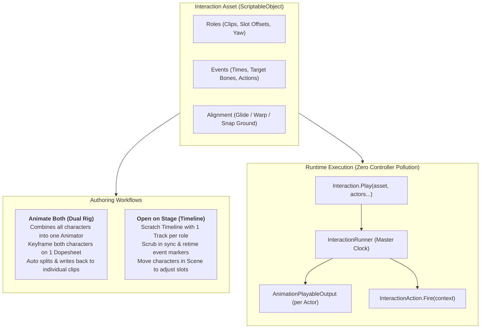
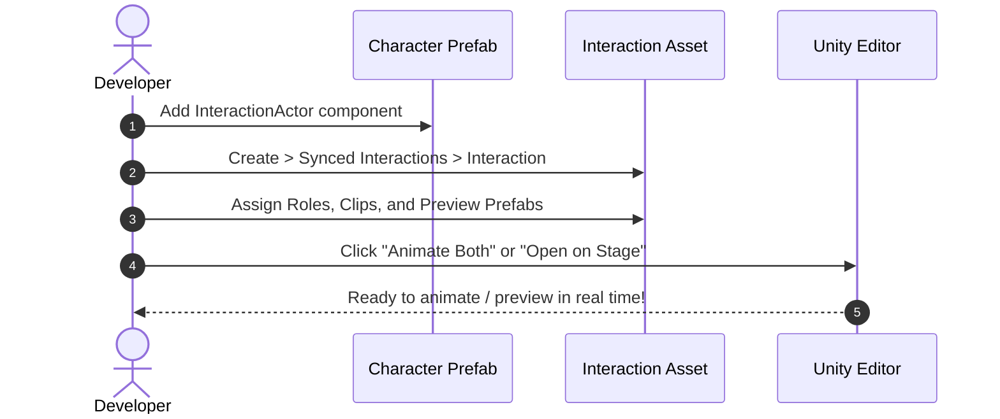

# Synced Interactions — User Manual & Architecture Guide

A modular, zero-controller-edit system for synchronized multi-character animations, executions, paired combat, and co-op interactions in Unity.

---

## Table of Contents
1. [System Architecture](#1-system-architecture)
2. [Quick Setup in 2 Minutes](#2-quick-setup-in-2-minutes)
3. [Creating an Interaction Asset](#3-creating-an-interaction-asset)
4. [Authoring Mode 1: Animate Both (Animation Window)](#4-authoring-mode-1-animate-both-animation-window)
5. [Authoring Mode 2: Open on Stage (Timeline)](#5-authoring-mode-2-open-on-stage-timeline)
6. [Bone Targeting & Scene Selection](#6-bone-targeting--scene-selection)
7. [Custom Game Actions (Dismemberment, VFX, Audio)](#7-custom-game-actions)
8. [Runtime Scripting & Gameplay API](#8-runtime-scripting--gameplay-api)
9. [Vetoes & Participant Callbacks](#9-vetoes--participant-callbacks)
10. [Authoring Modes Comparison](#10-authoring-modes-comparison)

---

## 1. System Architecture



---

## 2. Quick Setup in 2 Minutes



### Step 1: Add `InteractionActor` to your Prefabs
Attach `InteractionActor` to every character that can initiate or receive interactions.

| Prefab Hierarchy | How to configure `InteractionActor` |
| :--- | :--- |
| **Animator on Root** *(standard humanoid)* | Leave the **Animator** property empty (it auto-detects it). |
| **Animator on Child** *(FPS hands, weapon rigs, models)* | Drag the child object with the `Animator` into the **Animator** field. |

> [!NOTE]
> Movement adapters (`IInteractionMover`) are discovered automatically. Whether your character uses a `CharacterController`, `NavMeshAgent`, `Rigidbody`, or raw `Transform`, the actor adapts with zero manual wiring.

---

### Step 2: Create the `InteractionAsset`
Right-click in the Project Window:
**Create &rarr; Synced Interactions &rarr; Interaction**

Configure the core settings:
- **Roles**: Add entries for each character (e.g. `Attacker` and `Victim`).
- **Clip**: The `AnimationClip` for this character.
- **Preview Prefab**: The prefab to display when editing.
- **Offset & Yaw**: Position $(X, Y, Z)$ and rotation relative to the anchor role.
- **Anchor**: Choose `Role` (anchor to one character's position) or `World` (anchor to a fixed world spot).
- **Alignment**:
  - `Glide`: Characters smoothly slide into their slots over `alignTime` before the animation starts.
  - `Warp`: Characters instantly snap to slots.
  - `None`: Characters play in place.

---

## 3. Creating an Interaction Asset

### Key Inspector Fields:

| Setting | Type | Description |
| :--- | :--- | :--- |
| **Roles** | `List<InteractionRole>` | The participants in the interaction. Supports 2 characters or $N$ characters. |
| **Anchor** | `Role` or `World` | Which coordinate space the interaction aligns to. |
| **Anchor Role** | `string` | The role that stays fixed while others align to it. |
| **Alignment** | `Glide`, `Warp`, `None` | Method used to position actors at slot coordinates before playback. |
| **Align Time** | `float` | Duration in seconds for characters to glide into place. |
| **Snap To Ground** | `bool` | Raycasts down against `groundMask` to keep feet planted on slopes and terrain. |
| **Events** | `List<InteractionEvent>` | Timed moments during the animation that fire gameplay actions. |

---

## 4. Authoring Mode 1: Animate Both (Animation Window)

To edit keyframes of both characters on the **same dopesheet** at the same time:

1. Select your `InteractionAsset` in the Inspector.
2. Click **"Animate Both (Animation Window)"**.
3. Unity opens a clean staging scene:
   - Builds root `[Interaction Rig: <Asset>]` with an Animator driving a merged clip.
   - Mounts each character's animated root directly under the rig as `Attacker` and `Victim`.
   - Opens Unity's **Animation Window** with all keyframes visible together.

```
[Interaction Rig] (Parent Animator)
├── Attacker (e.g. Hands / Skeleton)  ──> Keyframed as "Attacker/..."
└── Victim   (e.g. Model / Skeleton)  ──> Keyframed as "Victim/..."
```

### Advantages:
- **Zero Missing Bones**: Curves map 1:1 to each character's bones.
- **Shared Timeline**: Scrub through the attack and reaction together; see punch impact vs. head recoil on the exact same frame.
- **Automatic Write-Back**: Curves are automatically split by prefix (`Attacker/...` &rarr; Attacker clip, `Victim/...` &rarr; Victim clip) and saved to disk.
- **Save & Exit**: Click **"Apply & Close Dual Rig"** in the Inspector to return to your scene.

---

## 5. Authoring Mode 2: Open on Stage (Timeline)

To preview the interaction with synchronized playback, retime events, and adjust slots interactively:

1. Select your `InteractionAsset`.
2. Click **"Open on Stage (Timeline)"**.
3. **Timeline Scrubber**: Drag the Timeline playhead to preview the synchronized animation with proper skinning and attachments.
4. **Interactive Slot Positioning**: Select either character in the Scene View and move/rotate them using Unity's transform gizmos. Their `offset` and `yaw` automatically update in the asset.
5. **Draggable Event Markers**: Drag markers on the Timeline marker track to change event timestamps. Right-click to add new events.
6. Click **"Close Timeline Stage"** to return to your scene.

---

## 6. Bone Targeting & Scene Selection

Events let you trigger gameplay actions at specific frames (e.g. neck bite at $t = 0.22\text{s}$, weapon impact at $t = 0.5\text{s}$).

Each event targets a character **Role** and a **Bone**. The Inspector provides multiple ways to select bones:

```
┌────────────────────────────────────────────────────────┐
│ Bone: [ mixamorig:LeftShoulder                       ] │
│       ├── Use Selected: "mixamorig:LeftShoulder"       │  <-- Click scene object, then click this!
│       ├── Drag-and-drop Transform from Hierarchy       │
│       ├── Preview bones > [Browse full skeleton tree]  │
│       ├── Humanoid > [Head, Chest, LeftHand, etc.]     │
│       └── (root)                                       │
└────────────────────────────────────────────────────────┘
```

> [!TIP]
> **Fastest Bone Selection**: Click any bone or mesh in the Scene View or Hierarchy, then click the top dropdown option: **`Use Selected: "<TransformName>"`**.

---

## 7. Custom Game Actions

Actions are modular, self-contained `[SerializeReference]` classes. Any project can add custom actions without touching the core package.

### Example: Dismemberment & Severed Limb Action

Create `Assets/Scripts/Interactions/DismemberAction.cs`:

```csharp
using System;
using UnityEngine;
using JunaidIRF.SyncedInteractions;

[Serializable]
public class DismemberAction : InteractionAction, IInteractionPreviewAction
{
    [Tooltip("Limb name or tag to sever")]
    public string limbName = "LeftArm";

    [Tooltip("Prefab to spawn at the cut location")]
    public GameObject severedPropPrefab;

    [Tooltip("Blood splatter FX prefab")]
    public GameObject bloodFxPrefab;

    /// <summary>Fired at runtime when the interaction timeline reaches this event.</summary>
    public override void Fire(InteractionContext context)
    {
        // context.actor: The character who owns the target bone
        // context.bone:  The exact resolved bone transform
        // context.handle: The running interaction handle
        // context["OtherRole"]: Access another participant by role name

        if (context.bone == null) return;

        // 1. Spawn blood effect at the bone position
        if (bloodFxPrefab != null)
        {
            GameObject.Instantiate(bloodFxPrefab, context.bone.position, context.bone.rotation);
        }

        // 2. Hide the attached limb mesh
        var smr = context.bone.GetComponentInChildren<Renderer>();
        if (smr != null) smr.enabled = false;

        // 3. Spawn severed limb prop with physics
        if (severedPropPrefab != null)
        {
            var prop = GameObject.Instantiate(severedPropPrefab, context.bone.position, context.bone.rotation);
            var rb = prop.GetComponent<Rigidbody>();
            if (rb != null) rb.AddForce(Vector3.up * 2f + Vector3.back * 3f, ForceMode.Impulse);
        }
    }

    // ─────────────────────────────────────────────────────────────────
    // IInteractionPreviewAction: Live Preview on Stage Timeline
    // ─────────────────────────────────────────────────────────────────

    /// <summary>Called while scrubbing on stage when the playhead passes this event.</summary>
    public void Preview(GameObject character, Transform bone, bool reached)
    {
        if (bone == null) return;
        var r = bone.GetComponentInChildren<Renderer>();
        if (r != null) r.enabled = !reached; // Hide limb when past event time
    }

    /// <summary>Called when the stage closes to restore character state.</summary>
    public void EndPreview(GameObject character)
    {
        foreach (var r in character.GetComponentsInChildren<Renderer>(true))
            r.enabled = true;
    }
}
```

> [!IMPORTANT]
> Because `DismemberAction` inherits from `InteractionAction`, it **automatically appears** in the inspector's **"Add action"** menu on every event!

---

## 8. Runtime Scripting & Gameplay API

### Triggering an Interaction via Code
```csharp
using UnityEngine;
using JunaidIRF.SyncedInteractions;

public class CombatController : MonoBehaviour
{
    [SerializeField] InteractionAsset takedownAsset;
    [SerializeField] InteractionActor playerActor;

    public void PerformTakedown(InteractionActor targetEnemy)
    {
        // Play directly
        InteractionHandle handle = Interaction.Play(takedownAsset, playerActor, targetEnemy);

        // Optional completion callbacks
        handle.OnFinished += h => Debug.Log("Takedown complete!");
        handle.OnCancelled += h => Debug.Log("Takedown was interrupted!");
    }
}
```

---

## 9. Vetoes & Participant Callbacks

### Preventing Interactions with Vetoes (`IInteractionVeto`)
Implement `IInteractionVeto` on any component on the character to reject interactions dynamically:

```csharp
using UnityEngine;
using JunaidIRF.SyncedInteractions;

public class EnemyCombatState : MonoBehaviour, IInteractionVeto
{
    public bool isStunned;
    public bool isInvulnerable;

    public bool CanInteract(InteractionActor partner, InteractionAsset asset, string role, out string reason)
    {
        if (isInvulnerable)
        {
            reason = "Target is invulnerable";
            return false;
        }

        // Only allow executions if the enemy is stunned
        if (role == "Victim" && !isStunned)
        {
            reason = "Target is not stunned";
            return false;
        }

        reason = null;
        return true;
    }
}
```

---

### Pausing AI & Input during Interactions (`IInteractionParticipant`)
Implement `IInteractionParticipant` on movement or AI controllers to freeze behavior cleanly during an interaction:

```csharp
using UnityEngine;
using JunaidIRF.SyncedInteractions;

public class EnemyBrain : MonoBehaviour, IInteractionParticipant
{
    public void OnInteractionStart(InteractionHandle handle, string role)
    {
        // Disable AI navigation and attack logic while in interaction
        enabled = false;
    }

    public void OnInteractionEnd(InteractionHandle handle, string role, bool cancelled)
    {
        // Resume AI logic once the interaction completes or cancels
        enabled = true;
    }
}
```

---

## 10. Authoring Modes Comparison

| Feature | Animate Both (Dual Rig) | Open on Stage (Timeline) |
| :--- | :--- | :--- |
| **Window Used** | Unity Animation Window | Unity Timeline Window |
| **Primary Purpose** | Keyframing, tweaking curves, posing | Scrubbing, slot layout, retiming events |
| **Dopesheet View** | Both characters on **one** dopesheet | Separate tracks per character |
| **Keyframe Editing** | Full curve and dopesheet tools | Right-click clip &rarr; edit in Animation |
| **Slot Positioning** | Fixed at slot offsets | Interactive move gizmo in Scene View |
| **Event Markers** | Animation event markers on dopesheet | Draggable markers on Timeline track |
| **Write-Back** | Automatic curve splitting & saving | Real-time asset synchronization |
