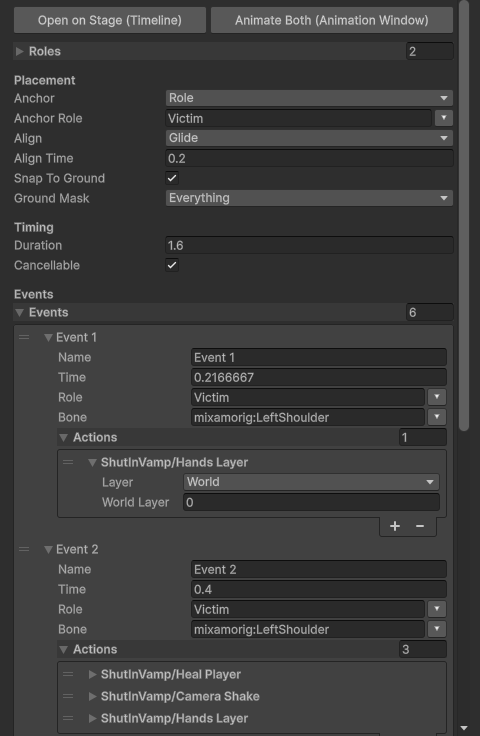
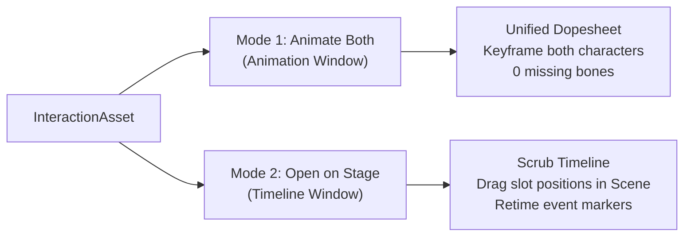
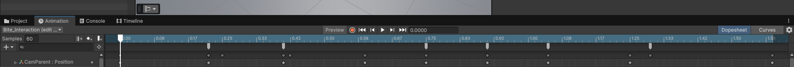

# 📸 Synced Interactions — Visual Guide & Inspector Reference

A comprehensive visual walkthrough of authoring, staging, and configuring synced interactions in Unity.

---

## 1. Interaction Asset Inspector

The **InteractionAsset** is the central ScriptableObject defining participant roles, slot alignments, and timed execution events.

  
  
<em>Studio Inspector view of <code>Bite_Interaction.asset</code> showing Roles, Anchor mode, Alignment, and Events.</em>

### Key Inspector Sections

| Section | Purpose | Best Practices |
| :--- | :--- | :--- |
| **Roles** | Defines participating actors (`Initiator`, `Victim`, `Partner`). | Always assign real preview prefabs to see live alignments in Stage mode. |
| **Slot Offset & Yaw** | Relative transform where the partner snaps before playing. | Use **Open on Stage** or Scene handles to place partners visually without typing numbers. |
| **Alignment** | How actors navigate to their slots (`Glide`, `Warp`, `None`). | Use `Glide` (0.2s–0.4s) for smooth transitions; enable ground raycasting to snap onto terrain. |
| **Events** | Timed markers firing modular `InteractionAction` callbacks. | Click **Use Selected** to bind target bone paths instantly from the Scene view. |

---

## 2. Authoring Workflows

### Mode 1: Animate Both (Unified Dopesheet)
- Click **Animate Both** in the asset Inspector.
- Both characters are mounted under a composite `[Interaction Rig]` with automatic hierarchy resolution.
- Keyframe and scrub both characters simultaneously in Unity's standard **Animation Window**.
- Modifying dopesheet event markers automatically synchronizes with `InteractionAsset.events`.

  
  
<em>Unity Animation Window showing both characters combined on a unified dopesheet with zero missing curves.</em>

### Mode 2: Open on Stage (Timeline Staging)
- Click **Open on Stage** to spawn preview actors in an isolated scene.
- Drag the Timeline scrubber to verify timing, dismemberment/sound events, and alignment arcs.
- Move or rotate preview characters directly in the Scene view; slot offsets update in real time.

---

## 3. Fast Bone Picking Workflow

Instead of typing deep hierarchy paths like `mixamorig:Hips/mixamorig:Spine/mixamorig:Neck`:

1. Open your interaction on **Stage** or in the **Dual Rig**.
2. Click any bone in the **Scene View** or **Hierarchy**.
3. In the Inspector event drawer, click **`Use Selected`**.
4. The exact relative transform path is resolved and populated automatically.
