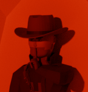
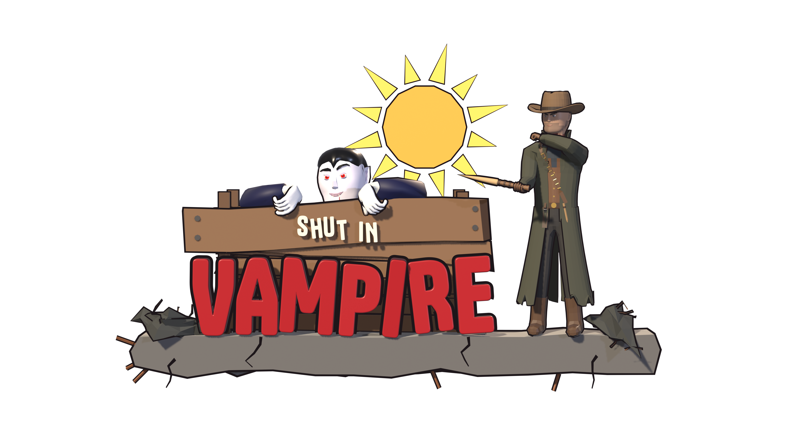
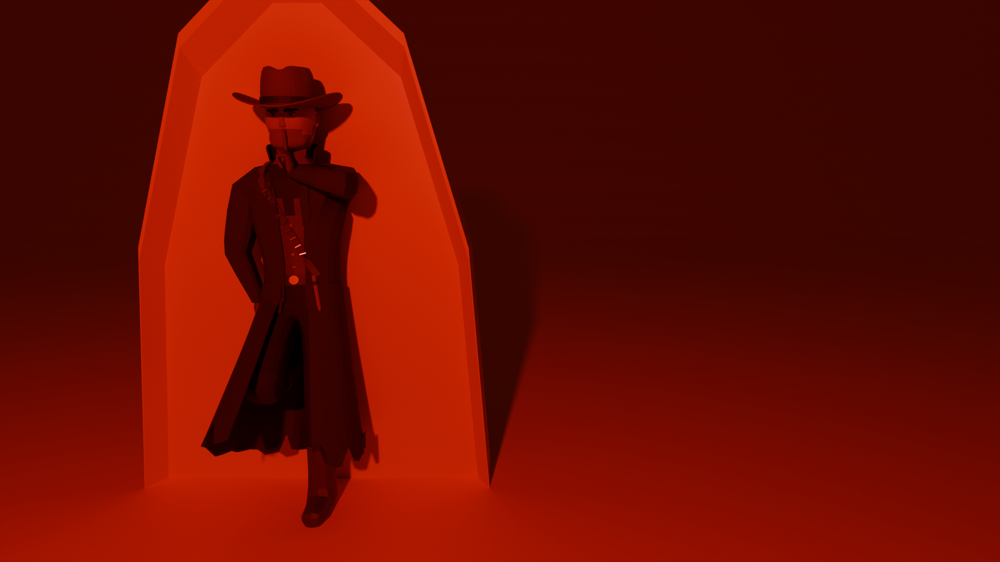

<div align="center">

<p align="center">
  
</p>

# Shut In Vampire

A first-person vampire brawler where the sun is the deadliest enemy.

<p align="center">
  <a href="https://unity.com"></a>
  <a href="https://github.com/JunaidIRF/ShutInVamp"></a>
  <a href="https://github.com/JunaidIRF/ShutInVamp"></a>
</p>

<p align="center">
  <a href="https://skillicons.dev">
    
  </a>
</p>

</div>

---

<p align="center">
  
</p>

## How to Play

- **The sun burns you** - step into sunlight and you catch fire, losing health fast. **Stay in the shade.**
- **Executions buy you time** - stun a hunter with a parry, then execute them for a short sun ward that lets you dash across a sunlit street.
- **Survive the waves** - hunters come in from the blocks around you, more of them and faster every wave.

## Controls

| Key | Action |
| --- | --- |
| `W` `A` `S` `D` | Move |
| `Mouse` | Look |
| `Shift` | Sprint |
| `Space` | Jump |
| `Ctrl` | Crouch (slide while sprinting) |
| `Left Click` | Claw attack |
| `Right Click` | Parry |
| `V` (hold) | Guard |
| `E` | Execute a stunned hunter |
| `F` | Inspect claws |
| `Esc` | Pause |

## Getting Started

Clone the repository, open it in **Unity 6000.6.5f1** and play the `MainMenu` scene:

```bash
git clone https://github.com/JunaidIRF/ShutInVamp.git
```
<p align="center">
  
</p>
